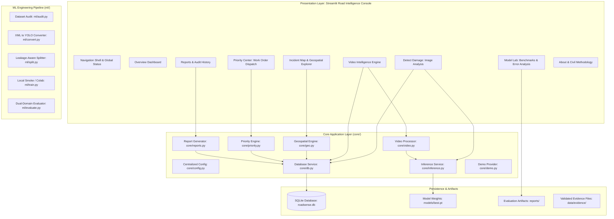

# RoadSense AI — Master Architecture & Project Plan (PLAN.md)

**Product Name:** RoadSense AI  
**Tagline:** *"See the Damage. Understand the Risk. Prioritize the Repair."*  
**Document Status:** Complete (Phase 1 Deliverable — Paused at Stop Gate)  
**Target Hardware:** Apple MacBook Air M4 (16 GB Unified Memory, macOS 26.5.2) + Google Colab T4 GPU  
**Lead Developer:** Undergraduate CSE Student Developer & AI Engineering Assistant  

---

## 1. System Overview & Epistemic Framework

RoadSense AI is an end-to-end road condition intelligence platform designed for municipal engineers, road inspection authorities, and university project-expo demonstrations. It automates damage detection from dashcam imagery and mobile video, maintains evidence-linked incident records in an auditable SQLite database, visualizes localized defects on interactive maps, and calculates deterministic inspection priorities to replace ad-hoc road maintenance dispatching.

### Epistemic Labeling Standard
To uphold strict scientific and engineering integrity, every statement in this document is labeled with one of three markers:
- `[Fact (Cited)]`: Grounded in official documentation, empirical code execution, primary literature, or direct dataset audits.
- `[Decision]`: An architectural, algorithmic, or design choice made by the engineering team to solve a verified requirement.
- `[Assumption]`: A working premise that will be verified or adapted as empirical implementation proceeds.

> [!IMPORTANT]
> **Operational Safety Notice:**
> Model detection confidence does **not** represent physical damage severity or structural hazard. RoadSense AI is an inspection prioritization and workflow management aid; it does **not** replace certified civil engineering structural evaluations or professional road-safety audits.

---

## 2. Dataset Research, Licenses, and Attributions

### 2.1 The RDD2022 Benchmark
- `[Fact (Cited)]`: The project utilizes the **Road Damage Dataset 2022 (RDD2022)**, released through the Crowdsensing-based Road Damage Detection Challenge (CRDDC 2022) at the IEEE International Conference on Big Data 2022.
  - **Paper Citation:** Arya, D., Maeda, H., Ghosh, S. K., Toshniwal, D., & Sekimoto, Y. (2022). *RDD2022: A multi-national image dataset for automatic Road Damage Detection*. arXiv:2209.08538 [cs.CV]. https://arxiv.org/abs/2209.08538
  - **Figshare Repository:** DOI `10.6084/m9.figshare.21431547.v1`, https://figshare.com/articles/dataset/RDD2022_-_The_multi-national_Road_Damage_Dataset_released_through_CRDDC_2022/21431547
  - **GitHub Repository:** Sekilab RoadDamageDetector, https://github.com/sekilab/RoadDamageDetector
- `[Fact (Cited)]`: **Dataset License:** Creative Commons Attribution 4.0 International (**CC BY 4.0**), confirmed via Figshare API query (`https://api.figshare.com/v2/articles/21431547`). Reuse, redistribution, and adaptation are explicitly permitted with proper attribution.
- `[Fact (Cited)]`: **Total Image Count:** Exactly **47,420 images** across six countries (seven partitions), verified from `File_List_CRDDC_RDD2022.txt`:
  - `China_Drone`: 2,401 train JPGs + 2,401 train XMLs (0 test)
  - `China_MotorBike`: 1,977 train JPGs + 1,977 train XMLs + 500 unlabelled test JPGs
  - `Czech`: 2,829 train JPGs + 2,829 train XMLs + 709 unlabelled test JPGs
  - `India`: 7,706 train JPGs + 7,706 train XMLs + 1,959 unlabelled test JPGs
  - `Japan`: 10,506 train JPGs + 10,506 train XMLs + 2,627 unlabelled test JPGs
  - `Norway`: 8,161 train JPGs + 8,161 train XMLs + 2,040 unlabelled test JPGs
  - `United_States`: 4,805 train JPGs + 4,805 train XMLs + 1,200 unlabelled test JPGs
  - *Summary:* 38,385 annotated training images + 9,035 unlabelled test images = 47,420 total.

### 2.2 Framework & Dependency Licensing
- `[Fact (Cited)]`: **Ultralytics YOLO (8.4.177):** Licensed under GNU Affero General Public License v3.0 (**AGPL-3.0**). All application source code using this framework will be completely open and locally auditable in this repository.
- `[Fact (Cited)]`: **PyTorch (2.12.1):** Modified BSD license.
- `[Fact (Cited)]`: **Streamlit (1.58.0):** Apache License 2.0.
- `[Fact (Cited)]`: **OpenCV (4.11.0):** Apache License 2.0.
- `[Fact (Cited)]`: **Plotly (6.9.0):** MIT License.
- `[Fact (Cited)]`: **Folium (0.20.0):** MIT License.

---

## 3. Ground-Truth XML Audit & Class Map Decision

### 3.1 Empirical XML Audit Results
`[Fact (Cited)]`: Streaming range requests were executed directly against the Pascal-VOC XML annotations inside `RDD2022_released_through_CRDDC2022.zip` on the official Figshare S3 mirror:

#### India Subset (Primary Training Domain: 7,706 XMLs)
- Total XML files audited: **7,706**
- Malformed XML files: **0**
- Empty XML files (Negative background images with 0 damage objects): **3,921** (50.88% of images!)
- Total Bounding Boxes: **8,203**
- Invalid Bounding Boxes ($x_{\max} \le x_{\min}$ or $y_{\max} \le y_{\min}$): **0**
- Observed Class Frequencies:
  1. `D40` (Potholes): **3,187** (38.85%)
  2. `D20` (Alligator Cracks): **2,021** (24.64%)
  3. `D00` (Longitudinal Cracks): **1,555** (18.96%)
  4. `D44` (White line blur): **1,062** (12.95%)
  5. `D01` (Longitudinal crack subtype): **179** (2.18%)
  6. `D10` (Transverse Cracks): **68** (0.83%)
  7. `D43` (Crosswalk blur): **57** (0.69%)
  8. `D11` (Transverse crack subtype): **45** (0.55%)
  9. `D50` (Manhole cover): **28** (0.34%)
  10. `D0w0` (Ground-truth human typo for D00): **1** (0.01%)

#### Czech Subset (Held-Out Domain Shift Benchmark: 2,829 XMLs)
- Total XML files audited: **2,829**
- Malformed XML files: **0**
- Empty XML files (Negative background images): **1,757** (62.11%)
- Total Bounding Boxes: **1,745**
- Invalid Bounding Boxes: **0**
- Observed Class Frequencies:
  1. `D00` (Longitudinal Cracks): **988** (56.62%)
  2. `D10` (Transverse Cracks): **399** (22.87%)
  3. `D40` (Potholes): **197** (11.29%)
  4. `D20` (Alligator Cracks): **161** (9.23%)

### 3.2 Class Mapping & Filtering Strategy
`[Decision]`: In alignment with the official CRDDC 2022 competition specification (`label_map.pbtxt`), the platform establishes a strict **4-Class Canonical Taxonomy**:

| Class ID | Code | Canonical Name | Civil Engineering Definition | Action in Converter |
|:---:|:---:|:---|:---|:---|
| **0** | `D00` | Longitudinal Crack | Linear crack running parallel to traffic direction along wheel paths | Retain directly. Map typo `D0w0` -> `D00`. Map subtype `D01` -> `D00`. |
| **1** | `D10` | Transverse Crack | Linear crack running perpendicular to the center line of the pavement | Retain directly. Map subtype `D11` -> `D10`. |
| **2** | `D20` | Alligator Crack | Interconnected polygonal map cracking caused by fatigue failure | Retain directly. |
| **3** | `D40` | Pothole | Bowl-shaped depression or structural cavity in the road surface | Retain directly. |

#### Filtering Out Non-Damage Annotations
`[Decision]`: The non-standard labels found in the raw XML files are handled as follows:
- `D43` (Crosswalk blur) and `D44` (White line blur): **Filtered out**. These represent faded painted road markings, not structural asphalt defects.
- `D50` (Manhole cover): **Filtered out**. Utility infrastructure is normal road furniture, not damage.
- `Repair` (Asphalt patch): **Filtered out**. Represents past maintenance rather than unaddressed defects.
- **Negative Sample Treatment:** Any image whose bounding boxes are all filtered out becomes a clean **negative background image** (0 labels in YOLO format). This is highly advantageous: training object detection models with negative background imagery prevents hallucinated false positives on clean road surfaces.

---

## 4. Leakage-Aware Dataset Splitting Method

### 4.1 The Video-Sequence Leakage Problem
- `[Fact (Cited)]`: In the RDD2022 dataset, imagery was captured via dashcams or smartphone mounts recording continuous video streams along driving routes at approximately 1 Hz. Consecutive filenames (e.g. `India_001240.jpg` and `India_001241.jpg`) capture the exact same section of roadway seconds apart.
- `[Fact (Cited)]`: Applying standard random image-level splitting (`train_test_split(shuffle=True)`) splits adjacent video frames across the train and validation sets. The model simply memorizes unchanging roadside buildings, trees, and lighting, yielding artificially high validation metrics that fail to generalize to novel roads.

### 4.2 Leakage-Aware Splitting Algorithm
`[Decision]`: To guarantee zero data leakage between training and evaluation:
1. **Filename Sequence Clustering:** Parse sequence IDs from image filenames. Any consecutive indices separated by $\le 2$ seconds/frames are assigned to the same contiguous route segment.
2. **Perceptual Image Hash (dHash) Verification:**
   - Compute a 64-bit difference hash (dHash) for every image.
   - For consecutive or near-consecutive frames, compute the Hamming distance $H(h_i, h_j)$.
   - If $H(h_i, h_j) \le 10$, the frames share significant visual background and are grouped into the same connected cluster.
3. **Cluster-Level Stratified Splitting:**
   - Entire route clusters are assigned atomically to either `train` or `val` (target split: 80% train, 20% val).
   - Stratification balances the presence of minority classes (`D10` transverse cracks) across splits.
   - Deterministic splitting with fixed random seed (`seed=42`).
4. **Immutable Split Manifests:**
   - Generate `train_manifest.txt` and `val_manifest.txt` with relative filepaths and SHA-256 checksums, stored in `data/manifests/`.

---

## 5. Candidate Model Benchmarking & Selection Plan

### 5.1 Local Hardware Measurement Results
`[Fact (Cited)]`: The lightweight Ultralytics YOLO models were empirically benchmarked on the developer's target machine (Apple MacBook Air M4, 16 GB Unified Memory, macOS 26.5.2) at batch size 1, image resolution 640x640, with 10 warmup and 30 timed iterations:

| Model Candidate | Framework | Parameter Count | Model File Size | Apple MPS Latency | CPU Latency | Apple MPS FPS | CPU FPS |
|:---|:---:|:---:|:---:|:---:|:---:|:---:|:---:|
| **yolo26n.pt** (Primary) | Ultralytics 8.4.177 | **2.57 M** | **5.29 MB** | **18.02 ms** | 37.79 ms | **55.5** | 26.5 |
| **yolo11n.pt** (Fallback) | Ultralytics 8.4.177 | **2.62 M** | **5.35 MB** | **17.36 ms** | 43.52 ms | **57.6** | 23.0 |
| **yolov8n.pt** (Baseline) | Ultralytics 8.4.177 | **3.16 M** | **6.25 MB** | **13.60 ms** | 40.33 ms | **73.5** | 24.8 |

### 5.2 Selection Rationale
- `[Decision]`: **Primary Architecture:** `yolo26n` (or `yolo26s` for Colab training if GPU budget permits). It represents the state-of-the-art compact architecture with minimal parameter footprint (2.57M parameters), ultra-fast MPS execution (18.02 ms / frame), and advanced multiscale feature extraction.
- `[Decision]`: **Fallback Architecture:** `yolo11n` (2.62M parameters, 17.36 ms MPS). It serves as a proven, highly resilient baseline if any architecture-specific quantization or export constraints arise.
- `[Decision]`: The platform will support selectable model weights via centralized configuration (`core/config.py`), enabling seamless switching between `yolo26n`, `yolo11n`, or a locally trained smoke-test checkpoint.

---

## 6. In-Domain & Unseen-Country Domain-Shift Evaluation Design

To prove generalization and avoid misleading expo demonstrations, RoadSense AI conducts a dual-tier evaluation protocol:

```
+-----------------------------------------------------------------------------------+
|                            EVALUATION PROTOCOL                                    |
+-----------------------------------------------------------------------------------+
|                                                                                   |
|  [Tier 1: In-Domain Evaluation]            [Tier 2: Unseen-Country Domain Shift]  |
|  Dataset: Held-Out India Validation Set    Dataset: Complete Czech Dataset        |
|  Images: ~1,540 images                     Images: 2,829 images (1,072 positive)  |
|  Characteristics:                          Characteristics:                       |
|   - Indian road conditions                 - Central European road infrastructure |
|   - Monsoon weathering & patch repairs     - European lane markings & materials   |
|   - Distinct vehicle camera perspective    - Completely unseen road geometry      |
|                                                                                   |
|                                   METRICS                                         |
|  Per-Class Precision, Recall, F1, mAP@0.5, mAP@0.5:0.95                           |
|  Domain Degradation Delta: ΔmAP = (mAP_India - mAP_Czech) / mAP_India             |
|  Error Taxonomy: False Positives (Shadows/Manholes) vs False Negatives (Thin)     |
+-----------------------------------------------------------------------------------+
```

### 6.1 Why Czech Republic as the Unseen Country?
- `[Fact (Cited)]`: Czech contains **2,829 training images** with **1,745 bounding boxes** exclusively in the 4 canonical damage classes (`D00`: 988, `D10`: 399, `D40`: 197, `D20`: 161).
- `[Decision]`: Unlike Norway (which is 10.6 GB, placing excessive bandwidth demands on training environments), Czech is compact (**257 MB**), cleanly annotated, and geographically and structurally distinct from India.
- `[Decision]`: All evaluation artifacts (precision-recall curves, confusion matrices, per-class F1 scores, sample true-positive/false-positive/false-negative images) will be exported to `reports/` as immutable JSON and PNG files. The **Model Lab** page will read directly from these physical artifacts, never fabricating numbers.

---

## 7. System Architecture & Technical Specifications



### 7.1 Database Schema (SQLite with Parameterized Queries)
`[Decision]`: SQLite is used with strict parameterized queries (`?` placeholders) to prevent SQL injection:

```sql
CREATE TABLE IF NOT EXISTS incidents (
    id INTEGER PRIMARY KEY AUTOINCREMENT,
    incident_uuid TEXT UNIQUE NOT NULL,
    timestamp DATETIME DEFAULT CURRENT_TIMESTAMP,
    image_path TEXT NOT NULL,
    thumbnail_path TEXT,
    video_source_path TEXT,
    video_frame_number INTEGER,
    
    -- Detection Metadata
    checkpoint_id TEXT NOT NULL,
    detected_classes TEXT NOT NULL, -- JSON array of detected class codes
    detection_count INTEGER NOT NULL,
    max_confidence REAL NOT NULL,
    raw_detections TEXT NOT NULL,   -- JSON array of {class, confidence, bbox: [x1, y1, x2, y2]}
    
    -- Geospatial Provenance
    latitude REAL,
    longitude REAL,
    location_provenance TEXT NOT NULL CHECK(location_provenance IN ('EXIF_GPS', 'USER_ENTERED', 'EXPLICIT_SYNTHETIC_DEMO', 'UNKNOWN')),
    road_name TEXT,
    road_classification TEXT CHECK(road_classification IN ('PRIMARY_ARTERIAL', 'SECONDARY_COLLECTOR', 'RESIDENTIAL_LOCAL', 'UNKNOWN')),
    
    -- Priority & Review
    priority_score REAL NOT NULL,
    priority_level TEXT NOT NULL CHECK(priority_level IN ('LOW', 'MODERATE', 'HIGH', 'CRITICAL', 'INSUFFICIENT_INFO')),
    priority_formula_version TEXT NOT NULL,
    
    -- Human-in-the-Loop Review
    review_status TEXT DEFAULT 'PENDING' CHECK(review_status IN ('PENDING', 'VERIFIED', 'MODIFIED', 'REJECTED')),
    human_verified_classes TEXT,
    human_urgency_modifier REAL DEFAULT 1.0,
    reviewer_notes TEXT,
    reviewed_at DATETIME
);

CREATE INDEX IF NOT EXISTS idx_incidents_timestamp ON incidents(timestamp);
CREATE INDEX IF NOT EXISTS idx_incidents_priority ON incidents(priority_level);
CREATE INDEX IF NOT EXISTS idx_incidents_location ON incidents(latitude, longitude);
```

### 7.2 Priority Ranking Engine Formula v1.0
`[Decision]`: Priority score $S \in [0, 100]$ is computed deterministically using the following formula:

$$S = \min\left(100, \, \left( w_{\text{class}} \cdot \bar{c} \cdot 40 \right) + \left( \min(N_{\text{cluster}}, 5) \cdot 6 \right) + \left( w_{\text{road}} \cdot 15 \right) + \left( w_{\text{human}} \cdot 15 \right) \right)$$

Where:
- $w_{\text{class}}$: Maximum damage class severity weight:
  - `D40` (Pothole): $1.0$ (immediate vehicular impact and tire hazard)
  - `D20` (Alligator Crack): $0.8$ (structural base failure requiring milling/overlay)
  - `D10` (Transverse Crack): $0.5$ (sealable surface fissure)
  - `D00` (Longitudinal Crack): $0.4$ (early-stage linear distress)
- $\bar{c}$: Confidence score of the primary detection ($c \in [0, 1]$).
- $N_{\text{cluster}}$: Count of verified repeat detections within a 25-meter spatial radius (frequency multiplier).
- $w_{\text{road}}$: Verified road classification weight:
  - `PRIMARY_ARTERIAL`: $1.0$ (high speed, heavy bus/truck traffic)
  - `SECONDARY_COLLECTOR`: $0.7$
  - `RESIDENTIAL_LOCAL`: $0.4$
  - `UNKNOWN`: $0.5$
- $w_{\text{human}}$: Human-in-the-loop urgency rating ($w_{\text{human}} \in [0.5, 1.5]$, default $1.0$).

#### Proposed Priority Category Bands
- **Critical (Score $\ge 75$):** Immediate inspection required within 24–48 hours.
- **High (Score $55 - 74$):** Scheduled inspection within 7 days.
- **Moderate (Score $35 - 54$):** Routine maintenance backlog (30 days).
- **Low (Score $< 35$):** Monitor on subsequent survey cycle.
- **Insufficient Information:** When coordinates, road class, and confidence inputs are absent or unverified.

---

## 8. User Interface Design System: "Road Intelligence Console"

### 8.1 Visual Palette & Aesthetic Identity
`[Decision]`: The platform adopts a cohesive, professional civil engineering command-center design language:
- **Base Shell & Background:** Deep Midnight Slate (`#0f172a` / `#1e293b`).
- **Analytic Card Surfaces:** Warm Off-White / Crisp White (`#ffffff` / `#f8fafc`) with subtle 1px border lines (`#e2e8f0`).
- **Safety Amber Accent:** Highway Construction Amber (`#f59e0b` / `#d97706`) for interactive controls, bounding box highlights, and moderate alerts.
- **Severity Alerts:** Hazard Red (`#ef4444`) strictly reserved for Critical priorities and severe potholes; Emerald Green (`#10b981`) for verified status and clean roads.
- **Typography:** Modern clean sans-serif (Inter / System font stack) with disciplined scale:
  - Page Title: 24px bold (no oversized giant headers)
  - Section Headings: 18px semi-bold
  - Body Text: 14px regular
  - Micro-metadata & Badges: 12px medium monospace
- **Branding:** Custom vector SVG logo combining a stylized road perspective contour with an amber detection bounding reticle.

### 8.2 Application Pages & Component Map
1. **Overview Dashboard:** High-level network condition summary, damage category distribution (Plotly), recent inspection feed, global model status banner, and quick demo launcher.
2. **Detect Damage (Image Analysis):** File validation, confidence threshold slider, split-view comparison (Original vs Annotated), bounding-box coordinates table, and one-click "Save to Incident Log".
3. **Video Intelligence:** Dashcam MP4/AVI upload, configurable frame sampling rate (1 FPS to 10 FPS), progress indicator, keyframe detection highlights, and multi-frame damage summary.
4. **Incident Map & Explorer:** Leaflet/Folium geospatial visualization, filter by damage type/priority/review status, linked side drawer showing photo evidence, and graceful offline tile fallback.
5. **Priority Center:** Deterministic triage queue, interactive weight configurator, human-in-the-loop verification buttons (Verify / Modify / Dismiss), and work order dispatch export.
6. **Model Lab:** Interactive model inspector reading physical artifacts in `reports/`, in-domain vs unseen-country benchmark comparison, confusion matrix viewer, and false-positive/negative error breakdown.
7. **Reports & History:** Filtered incident table, audit history log, and one-click verified CSV and JSON export.
8. **About & Civil Methodology:** RDD2022 dataset citation, CC BY 4.0 license details, damage taxonomy guide, deterministic priority formula documentation, and civil safety disclaimer.

---

## 9. Risk Analysis & Mitigation Matrix

| Risk ID | Identified Risk | Impact | Likelihood | Technical Mitigation Strategy |
|:---:|:---|:---:|:---:|:---|
| **R1** | **Sequence Leakage in Train/Val Split** | High | High | Implement sequence grouping + perceptual hash clustering (dHash) to guarantee adjacent video frames never cross splits. |
| **R2** | **Extreme Class Imbalance (e.g. D10 vs D40)** | Med | High | In India subset, D40 has 3,187 instances while D10 has 68. Converter enables class-weighted loss and reports per-class metrics rather than global mAP alone. |
| **R3** | **Hallucinated Coordinates on Unlocated Images** | High | Med | Strict provenance enum (`EXIF_GPS`, `USER_ENTERED`, `EXPLICIT_SYNTHETIC_DEMO`, `UNKNOWN`). Zero location data displayed on map unless provenance is valid. |
| **R4** | **Offline Demonstration Failure at Expo** | High | Med | Self-contained demo mode with pre-cached local assets and synthetic database records. Folium uses local SVG/tile fallback if internet is unavailable. |
| **R5** | **GPU Unavailability on Local MacBook** | Med | Low | PyTorch verified on Apple Silicon Metal Performance Shaders (`mps`) providing 55+ FPS. Full 50-epoch training delegated to self-contained Google Colab notebook. |
| **R6** | **Ultralytics AGPL License Constraints** | High | Low | Platform codebase is completely open-source. For commercial enterprise use, documentation clearly explains AGPL requirements and commercial licensing options. |

---

## 10. Master Acceptance Checklist (16 Mandatory Criteria)

- [ ] **AC 1: Clean Setup** — Environment reproduces cleanly from documented steps on macOS and Linux.
- [ ] **AC 2: Zero Unhandled Exceptions** — Application boots and navigates across all pages without crash.
- [ ] **AC 3: Real Inference Execution** — Valid images run through real YOLO weights on MPS/CPU.
- [ ] **AC 4: Standardized Detection Schema** — Output contains class code, human name, confidence, and bounding box coordinates `[x1, y1, x2, y2]`.
- [ ] **AC 5: Helpful Validation Errors** — Corrupted images, unsupported video codecs, or out-of-bounds files produce actionable user guidance.
- [ ] **AC 6: Video Sampling Compliance** — Video processor strictly samples at user-configured interval (e.g. 1 frame/sec) without duplicate-incident auto-inflation.
- [ ] **AC 7: SQLite Persistence & CRUD** — Incidents create, read, update review status, filter, and export cleanly via parameterized SQL.
- [ ] **AC 8: Deterministic Priority Calculation** — Given identical inputs and configuration weights, priority score is 100% reproducible.
- [ ] **AC 9: Strict Location Provenance** — Absence of EXIF/user location never results in invented or estimated GPS coordinates.
- [ ] **AC 10: Transparent Missing-Weights Handling** — If `models/best.pt` is missing, UI clearly states status and offers guided demo mode.
- [ ] **AC 11: Demo Mode Provenance Separation** — Demo assets and cached detections are unambiguously badged `"CACHED — not live inference"`.
- [ ] **AC 12: Grounded Model Lab Metrics** — Every chart, metric, and curve in Model Lab links to a physical file in `reports/`.
- [ ] **AC 13: Automated UI Test Suite** — Streamlit native `AppTest` executes primary workflow with zero browser overhead via `pytest`.
- [ ] **AC 14: Zero Non-Functional Controls** — Every button, slider, and selector in the UI triggers a concrete, testable action.
- [ ] **AC 15: Self-Contained Expo Documentation** — Complete `README.md`, viva question guide, 3-minute pitch, and architecture documentation.
- [ ] **AC 16: Truthful Verification Report** — Final `VERIFICATION_REPORT.md` cleanly separates passed tests, unexecuted components, and known limitations.

---

## 11. Next Steps (Proceeding to Phase 2 Upon Approval)

1. **Wait for Stop Gate Reply:** Await user confirmation (`"approved"`).
2. **Phase 2 Execution:**
   - Establish complete repository layout (`app/`, `core/`, `ml/`, `models/`, `data/`, `reports/`, `docs/`, `tests/`).
   - Implement centralized config (`core/config.py`), logging, and initial launchable Streamlit shell.
   - Initial git commit for Phase 1.
